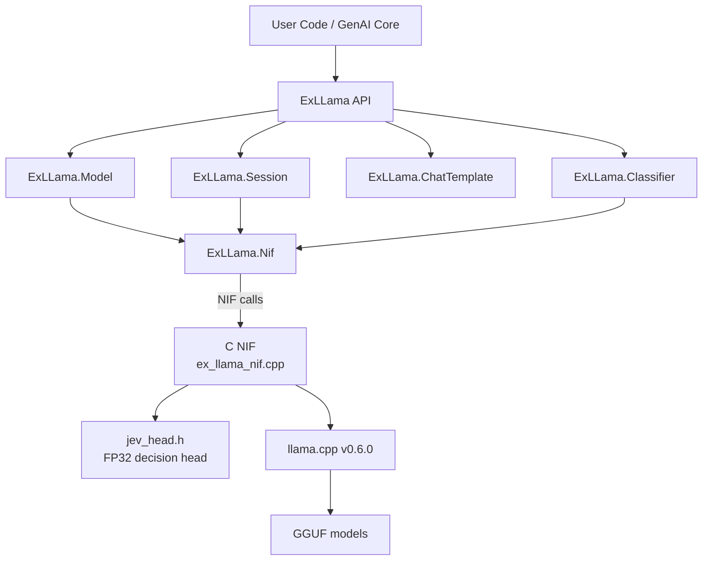

# Project Architecture

## Overview

ExLLama is an Elixir NIF wrapper around llama.cpp for loading and running
GGUF-format language models from the BEAM. It has two layers: an Elixir API
(model/session handles, chat templating, classifier provider) and a native C/C++
NIF (`c_src/ex_llama_nif.cpp`) that owns the llama.cpp model and context
resources. The native layer was rewritten from an earlier Rust/Rustler crate to
a hand-written C NIF at 0.2.0; there is no Rust code in the tree today.

On top of plain generation, the library implements the GenAI Core classifier
contract (`ExLLama.Classifier` behaviour `GenAI.Classifier.ProviderBehaviour`)
by running a GGUF backbone forward pass and applying a separate FP32 decision
head (JEVH0001 format) — no token sampling.

## System Diagram

## Core Components

| Component | Purpose | Implements in |
|-----------|---------|---------------|
| `ExLLama` | Main API — load_model, create_session, chat_completion, classify | `lib/ex_llama.ex` |
| `ExLLama.Model` | Model handle, tokenization, embeddings, metadata | `lib/ex_llama/model.ex` |
| `ExLLama.Session` | Inference context — advance/complete/stream/context ops | `lib/ex_llama/session.ex` |
| `ExLLama.Nif` | C NIF stubs + bridge shims to the C NIF surface | `lib/ex_llama/nif.ex` |
| `ExLLama.ChatTemplate` | Behaviour + 18 format implementations | `lib/ex_llama/chat_template*` |
| `ExLLama.Classifier` | GenAI classifier provider (text, choice/boolean/score) | `lib/ex_llama/classifier.ex` |
| Native layer | llama.cpp resources + classifier head, NIF functions | `c_src/ex_llama_nif.cpp` |

→ *Components ↔ directories: see [PROJ-LAYOUT.md](PROJ-LAYOUT.md)*

## Data Flow

Model loading builds a `ModelRes` (owning `llama_model*`) behind a NIF resource;
sessions wrap a `CtxRes` (`llama_context*` + non-owning model pointer + mutex).
All inference NIFs run on `DirtyCpu` schedulers so long inference does not block
normal BEAM schedulers. Context text, seed, model, and params are stashed in the
calling process's dictionary keyed by the context ref, so a session created in
one process can be driven from another. Chat completion orchestrates template
formatting → session creation → context injection → per-choice completion →
response extraction into a `GenAI.ChatCompletion`.

→ *See [arch/data-flow.md](arch/data-flow.md) for details*

## NIF Interface

The C NIF exposes ~30 functions across model, session/inference, and classifier
domains, plus template application. Config-bearing calls (load_model,
create_context, completion, embeddings, classifier head ops) are `DirtyCpu`;
lightweight vocabulary lookups run on normal schedulers. The Elixir `Nif`
module keeps the historical `__model_nif_*__` / `__session_nif_*__` bridge names
and translates them onto the current C NIF surface, wrapping raw references in
the expected structs.

→ *See [arch/nif-interface.md](arch/nif-interface.md) for details*

## Chat Template System

Behaviour-based polymorphism with 18 implementations under
`lib/ex_llama/chat_template/`. Selection via `meta[:template]`, defaulting to
`ExLLama.ChatTemplate.Zephyr`. Each implements `to_context/3` and
`extract_response/3`. The `chat_templates/` Jinja reference directory of earlier
revisions is gone; formats now live only as Elixir modules.

→ *See [arch/chat-templates.md](arch/chat-templates.md) for details*

## Native Classifier

`ExLLama.Classifier` loads a GGUF backbone and a JEVH0001 FP32 head, then answers
Core classifier questions (choice/boolean/score) with one backbone forward pass
per question, reading the last-token hidden state and applying the normalized
linear head. Image/audio/video modalities are rejected.

→ *See [jev-classifier.md](jev-classifier.md) for setup and validation*

## Key Decisions

- **C NIF over Rust (0.2.0)**: direct C++ against llama.cpp removed the extra
  Rust/Rustler binding layer and its version lag behind upstream
  (see CHANGELOG 0.2.0).
- **Dirty CPU schedulers**: keeps large-inference NIFs off normal schedulers.
- **Resource-based lifetime**: model/context/head are NIF resources with
  destructors, not BEAM-side handles into raw pointers.
- **Process-dictionary session state**: context text/seed/params keyed by the
  context ref, so sessions are portable across processes without a wrapper process.
- **GenAI Core integration**: returns `GenAI.ChatCompletion` / classifier structs
  via the `genai_core` dependency.

## Technology Stack

| Layer | Technology |
|-------|------------|
| API | Elixir 1.19 / OTP 28 |
| NIF | Hand-written C/C++ NIF (`erl_nif.h`) |
| ML Runtime | llama.cpp `v0.6.0` (submodule), cmake static build |
| Model Format | GGUF; classifier head JEVH0001 (FP32) |
| Test Model | TinyLlama 1.1B Chat Q4_K_M |
