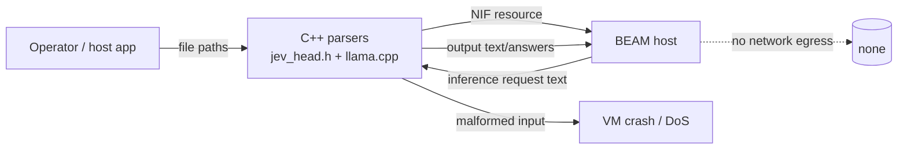

# Threat Model

<!-- 〚📁:03716ae2-208d-5ffd-8bcf-af2d4bcb8077〛 docs/THREAT-MODEL.md :: Living threat model for the local-inference library -->

## Overview

ExLLama is a library, not a service: it is linked into a host BEAM application
and performs local inference over llama.cpp. It exposes **no network listener,
no HTTP client, and no credential handling** — `lib/` makes no outbound calls
(no Finch/HTTPoison/`:httpc`) and the tree carries no API keys or endpoints.
The crown jewels are therefore (a) **BEAM process integrity**, which a native
NIF crash can take down wholesale, and (b) the **integrity of the model/head
files** it loads, which determine what the host application's AI output is.

Trust boundaries: operator-supplied file paths (GGUF model, JEVH0001 head) →
C++ parsers → llama.cpp → the BEAM. Everything downstream of a loaded model is
trusted by the host; the model file itself is not.

## Attack Surface

→ *Enumerated below; see [PROJ-ARCH.md](PROJ-ARCH.md) and [PROJ-LAYOUT.md](PROJ-LAYOUT.md) for grounding*

Entry points verifiable from source:
- `ExLLama.load_model/2`, `ExLLama.load_classifier/3` — take file paths.
- `ExLLama.Classifier.classify/2` — takes untrusted request text + questions.
- Session completion APIs — take prompt text and `max_tokens`.
- Process-dictionary session state keyed by ctx ref — cross-process, not a security boundary.

## Vulnerability Register

| ID | Severity | STRIDE | Component | Status |
|----|----------|--------|-----------|--------|
| T-001 | High | DoS / Elevation | Malformed GGUF or head file crashes the C++ NIF and takes the VM down (NIF crashes are not catchable) | Partial — head parser validates; llama.cpp parsing is upstream's responsibility |
| T-002 | Medium | Tampering | Untrusted model/head files silently change classifier decisions | Partial — head sha256 recorded in `classifier.metadata`; no signature enforcement |
| T-003 | Medium | DoS | Unbounded `max_tokens` / very large prompts consume CPU/memory on DirtyCpu schedulers | Open — caller-controlled; no library cap |
| T-004 | Low | DoS | Classifier fan-out over many questions serialised per model mutex; 2..256 option limit enforced | Mitigated |
| T-005 | Low | Info disclosure | Session state in process dictionary is visible to any code in the owning process | Accepted — same-process trust |
| T-006 | Medium | Supply chain | llama.cpp submodule (external repo) and Hex deps pin version/ref; unpinned upstream changes flow via submodule bump | Partial — submodule pinned to `v0.6.0`; CI installs from `mix.lock` |

Boundary checks that exist in `c_src/jev_head.h`: magic `JEVH0001`, size
16 B..128 MiB, `hidden` 1..65536, `classes == 256`, exact length match, positive
`sd`, finite features, option count 2..256.

## Mitigation Coverage

2 low accepted/mitigated · 4 medium/high partial · 1 open (T-003). The dominant
residual risk is T-001: a hostile or corrupt model/head file is parsed inside the
VM by C++, and a fault there is not catchable by the host.

## Residual Risk

- **Untrusted model files (T-001/T-002)** are accepted: the library's contract is
  "load a file the operator supplies". Hosts that accept models from untrusted
  sources should validate/sign them before calling `load_model/load_classifier`.
- **Caller-controlled resource use (T-003)**: `max_tokens` and prompt size are
  the caller's responsibility; the library documents no cap.
- **No secrets / no egress**: because the library performs local inference only,
  there are no credentials or endpoints to leak. This is a property to preserve —
  any future remote-provider adapter must live outside this library (GenAI
  provider adapters), keeping ExLLama credential-free.
